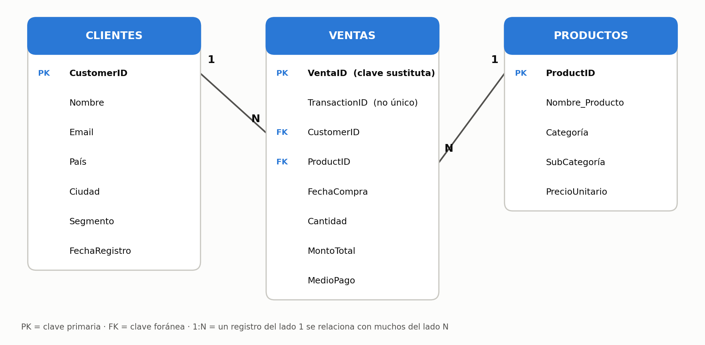

# Evaluación final · Análisis de ventas retail

Proyecto final del programa de Data Analytics (Coderhouse, módulo 11), entregado el 08/10/2026. A partir de un dataset de ventas de una tienda online de tecnología, accesorios y muebles de oficina, se modela la base en SQL Server, se revisa la calidad de los datos, se responde una consulta de negocio y se presentan los hallazgos al equipo de marketing.

> Proyecto académico sobre el dataset de práctica de la cátedra. El dataset no indica la moneda, por eso los montos se expresan solo con el símbolo `$`. Los datos no se incluyen en este repositorio.

## Preguntas de negocio
1. ¿Qué se vendió, y a quién, en el último mes registrado?
2. ¿Cómo se estructuran las tablas que lo responden?
3. ¿Cómo evoluciona la facturación mes a mes?
4. ¿De qué categorías y segmentos de clientes depende el negocio?

## Resultados principales
| Hallazgo | Dato |
|---|---|
| Facturación total (05/04/2024 – 07/04/2025) | $1.251.923,91 en 3.000 transacciones, 200 clientes, 8 países |
| Dependencia de una categoría | Tecnología concentra el 80,7% de la facturación |
| Volumen vs. valor | Accesorios: 33,7% de las transacciones, 6,0% de la facturación |
| Segmentos | Premium tiene el ticket promedio más bajo ($364, frente a $407 en Estándar y $471 en Básico) |
| Consulta de los últimos 30 días | 257 ventas entre el 08/03/2025 y el 07/04/2025, por $116.728,78 |

## Calidad de datos
| Problema | Magnitud | Decisión |
|---|---|---|
| `MontoTotal` vacío | 10 filas | Se recalcula como `Cantidad × PrecioUnitario` con `COALESCE` |
| `Cantidad` vacía | 20 filas | No se imputa |
| `TransactionID` repetido | 5 identificadores, en ventas distintas | Se conservan las 3.000 ventas y se usa `VentaID` como clave primaria |
| Ventas sin cliente o producto | 0 | Las claves foráneas lo garantizan |
| Meses incompletos | Abril 2024 y abril 2025 | Se marcan en los gráficos y no se comparan |

## Modelo de datos

`Ventas` es la tabla de hechos y se relaciona de uno a muchos con `Clientes` y con `Productos`. El modelo está normalizado: si cambia un precio, se actualiza un solo registro.

## Contenido de la carpeta
| Archivo | Descripción |
|---|---|
| `sql/01_crear_tablas.sql` | Crea la base `evaluacion_final` y las tres tablas con sus claves |
| `sql/02_revision_calidad.sql` | Cuenta nulos, identificadores repetidos y rango de fechas |
| `sql/03_ejercicio1_ultimos_30_dias.sql` | Consulta dinámica: `MAX(FechaCompra)` menos 30 días, con `INNER JOIN` y `COALESCE` |
| `sql/04_analisis_exploratorio.sql` | Facturación por mes, por categoría y por segmento |
| `presentacion/M11_Presentacion_Final.pdf` | Presentación ejecutiva: contexto, proceso, hallazgos y recomendaciones |

## Cómo reproducirlo
1. Ejecutar `sql/01_crear_tablas.sql` en SQL Server (SSMS).
2. Cargar en las tablas los tres CSV del dataset de la cátedra (por ejemplo con el asistente de importación de SSMS), dejando los vacíos como `NULL`.
3. Ejecutar los scripts `02`, `03` y `04`. Cada uno indica al final el resultado esperado.
